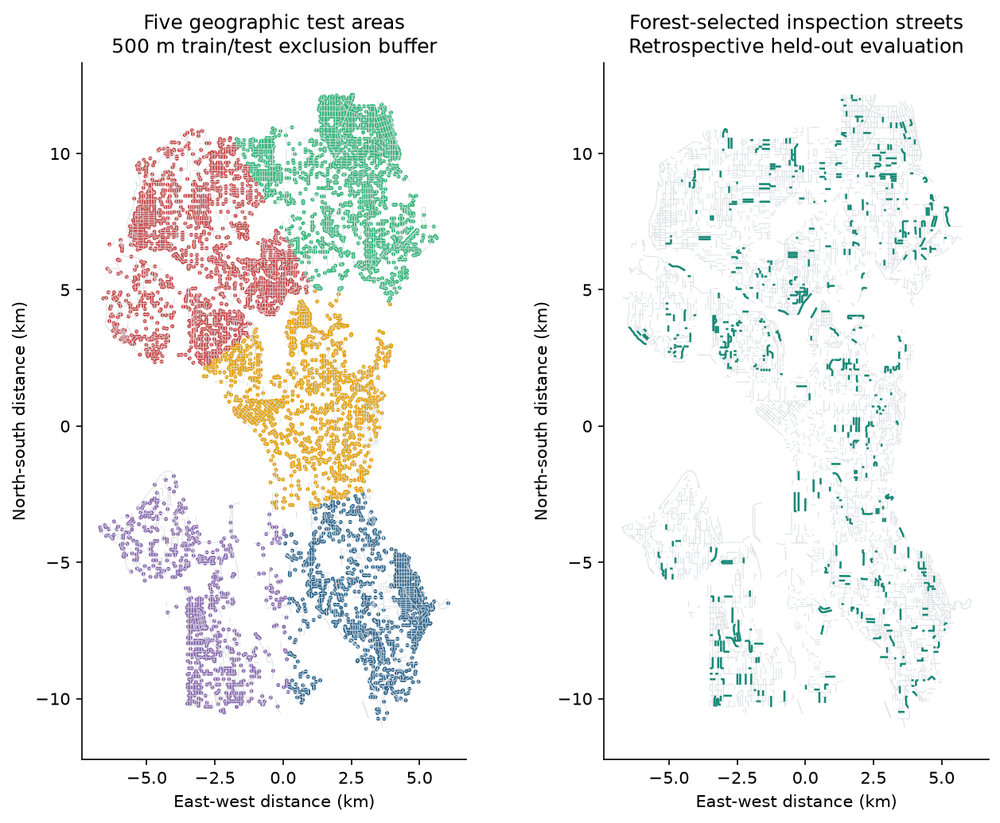
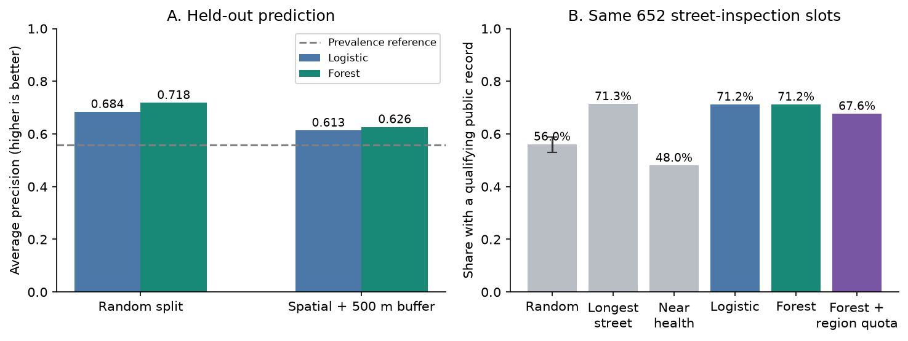
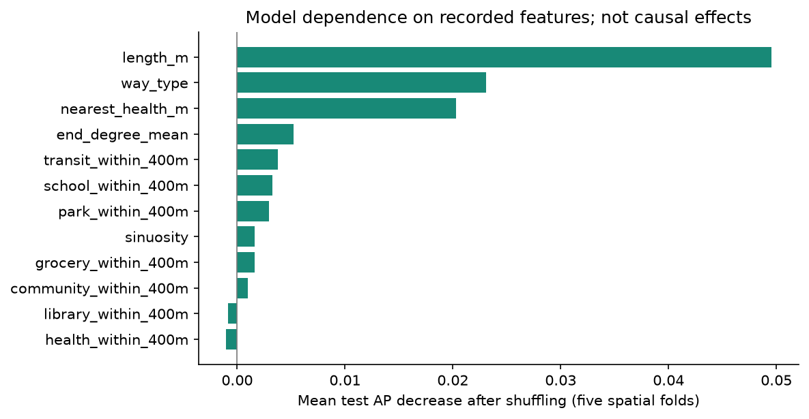

# 公开街道记录能否帮助安排调查：西雅图学习实验

运行日期：2026-10-26。数据、代码、逐路段预测和已运行 Notebook 随项目提供。

**本次实验中，随机森林优于随机抽查，但没有超过“优先调查长路段”的简单规则。** 在相同的 652 个路段调查名额下，随机森林选中了 464 条具有合格公开障碍记录的路段，长路段规则选中了 465 条，随机抽样平均选中 365.25 条。结果支持进一步研究调查排序，尚不足以证明采用复杂模型优于合理的简单方法。

这是对历史公开记录的回溯性检索，不是新的现场发现，也不估计道路改造效果。

## 问题与数据

问题是：隐藏已调查道路的标签，仅根据道路几何与周边设施，能否更有效地把调查名额分给有公开障碍记录的道路？如果同时要求各社区获得名额，检出比例如何变化？

实际下载的数据包括 21,224 条道路、127,773 条聚合标注与 4,344 个设施地点。[cite:1][cite:2][cite:3] 排除平台关闭、无图像、禁用和 `outdated=true` 的道路后，保留 7,916 条当前开放道路；要求调查次数至少为 2，得到 6,500 条评估道路，涉及平台的 79 个社区，3,633 条有合格障碍记录，比例为 55.89%。

“合格”定义为缺失坡道、路面问题、障碍物或缺失人行道；除缺失人行道外，严重度中位数至少为 2；同时确认计数至少为 2，且超过否认计数。合计 10,588 条聚合记录关联到评估样本。

负例的含义是没有符合这一定义的记录，不是确认没有问题。`audit_count>=2` 也不意味着两位独立调查者。原始记录和筛选后的条数可在 `data_quality.json` 复核。

这些合格记录的平均图像年份中，94.37% 不晚于 2021 年。该比例来自平台的聚合图像日期，不代表照片均在同一时间拍摄。尤其需要注意，`outdated=false` 过滤的是道路版本，不保证照片或障碍状态足够新。

## 方法

使用道路长度、曲折度、端点连接度、道路类型、400 米内七类设施数量及最近健康类地点的直线距离训练逻辑回归与随机森林。障碍数量、目标、调查次数、区域编号和位置坐标不作为模型输入。

设施的 `health` 类包含医院、诊所、医生服务与药房；它不等同于基层医疗服务。[cite:3] 所有设施距离均为直线邻近指标，不是步行时间。

随机验证采用五折划分。主验证把城市路段中点划为五个空间测试区，每次留出一个区，并排除距测试中点不足 500 米的训练路段。各折实际最小距离为 500.34—506.07 米。模型超参数固定，不使用测试答案选参。

图 1。左侧颜色表示五个地理测试区域；不表示风险等级。右侧绿色为随机森林按各测试区约 10% 名额选中的路段。灰线为用于分析的当前开放道路。该图展示回溯实验的分区和名单，不提供当前导航或工程建议。

空间缓冲以路段中点定义，因此不保证所有道路几何和设施邻域完全隔离。随机与空间划分同时改变训练规模及区域分布，成绩变化不能全部归因于某一种泄漏。

## 预测结果

| 模型 | 验证方式 | 合并折外 AP | ROC-AUC | Brier 分数，越低越好 |
|---|---|---:|---:|---:|
| 逻辑回归 | 随机 | 0.6835 | 0.6499 | 0.2290 |
| 随机森林 | 随机 | 0.7181 | 0.6976 | 0.2174 |
| 逻辑回归 | 空间＋500 米缓冲 | 0.6132 | 0.5598 | 0.2486 |
| 随机森林 | 空间＋500 米缓冲 | 0.6261 | 0.5864 | 0.2514 |

AP 衡量排序质量，不是准确率。上述 AP 是合并所有折外预测的描述性值；不同地区的正例比例和评分校准可能不同，逐折指标也保存在 `model_metrics.csv`，不能只凭合并值声称跨地区泛化稳定。

随机森林 AP 从随机划分的 0.7181 降到空间验证的 0.6261。五个空间折 AP 分别约为 0.643、0.478、0.765、0.599、0.753，差异明显。当前实验没有重复地理分区或训练样本量匹配，因此这些数值表示所选划分下的观察，不是对所有划分的统计置信区间。

随机森林空间验证的 Brier 分数还略高于逻辑回归。这提醒模型的排序和概率质量是不同问题，不能把较好的 AP 自动解释为更可靠的概率。

## 相同调查名额下的选择

各空间测试区分别取约 10% 路段，向上取整后共 652 个名额。模型分数只在同一测试区内部排序，再合并名单，避免跨折直接比较未经校准的分数。

| 策略 | 名额 | 选中有记录路段数 | 记录比例 | 社区覆盖比例¹ | 入选路段平均长度 |
|---|---:|---:|---:|---:|---:|
| 随机抽查，200 次平均 | 652 | 365.25 | 56.02% | 90.77% | 136.5 米 |
| 长路段优先 | 652 | 465 | 71.32% | 92.54% | 335.3 米 |
| 邻近健康设施优先 | 652 | 313 | 48.01% | 68.04% | 127.5 米 |
| 逻辑回归排序 | 652 | 464 | 71.17% | 93.05% | 286.9 米 |
| 随机森林排序 | 652 | 464 | 71.17% | 81.09% | 200.2 米 |
| 随机森林＋社区名额 | 652 | 441 | 67.64% | 100.00% | 199.7 米 |

¹ 各测试区“被选中社区数／可选社区数”的平均值，不是人口覆盖率，也不是全市社区数简单相除。

图 2。左侧展示合并折外 AP；虚线为样本正例比例，作为理解任务难度的参考。右侧为同名额检出比例。随机抽查误差条表示 200 次抽样结果的第 5—95 百分位，范围为 53.06%—58.74%，不表示现实障碍率的置信区间。其余方案为固定名单，不绘制虚假的重复实验误差条。

随机森林相对随机抽查平均多选中 98.75 条合格记录路段，相差 15.15 个百分点；但长路段规则多选中 1 条。不能据此宣称模型优于长路段规则，也不应将 1 条差异解读为稳定优势。

长路段规则入选道路平均更长。随机森林与其检出数量相近、平均路段长度较短，是值得进一步检验的现象；目前没有真实调查工时或路线接续成本，不能直接称为节省人力。不同路段长度也会改变“至少存在一条问题记录”的机会，因此下一步需要控制曝光长度和调查成本。

按社区轮流给名额后，社区覆盖从 81.09% 提高到 100%，合格记录从 464 条降到 441 条。这展示了一种空间覆盖目标与总检出数量之间的取舍。该规则没有人口、年龄和需要权重，不能据此断言它对老年人或其他弱势群体更公平。交通公平需要明示受益对象、最低服务目标与分配准则。[cite:4]

预算为 5% 和 20% 时的结果也已实际计算，见 `policy_summary.csv`。在这两个比例下，长路段规则分别找到 249、891 条记录，随机森林为 237、882 条，没有观察到森林超过该规则。

## 模型依赖哪些信息

图 3。在空间测试集打乱单个特征后，计算随机森林 AP 的变化，再对五折取平均。每个特征每折打乱三次。该图解释模型依赖哪些信息，不估计特征对道路状态的因果效应。

道路长度、道路类型和最近健康设施距离对模型预测影响较大。长度排在前面，与长路段基线表现较好相一致；可能同时反映实际环境差异、较长道路更有机会出现至少一条记录，以及调查覆盖习惯。当前设计不能分离这些解释。

该分析没有被用于回头挑选模型特征或调整超参数。个别特征打乱后 AP 略有提高，不足以单独证明该特征无用。

## 目前回答了什么

本项目完成了从真实公开数据到特征、模型、空间验证、策略比较和可复现结果的完整流程。主要发现是：简单规则具有很强的竞争力，模型成绩依赖验证划分，增加社区覆盖要求会改变调查名单和检出比例。

尚未回答的是：模型能否找到今天仍存在、此前未知的障碍；能否在相同真实调查工时下超越简单规则；能否改善老年人的服务可达性。要回答这些问题，需要独立的新观测、真实成本或行为数据。

适合学习者独立完成的下一步是固定模型，对空间缓冲距离和训练样本量开展控制实验。进一步研究可补充按道路长度与出行成本定义的调查预算、时间外验证及外部城市验证。

## 复现与检查

运行 `python analysis.py` 可从随附快照重新计算。环境实际版本记录在 `results/run_config.json`；原始数据哈希与下载时间见 `data/raw/manifest.json`。

`checks.py` 独立复核数据哈希、样本对应、目标数量、空间缓冲、合并模型指标、逐路段名单及分子分母。Notebook 已实际逐格执行并保存输出。图表已渲染并目视检查。

代码和文稿由 AI 辅助制作；学习者应将本项目作为理解、复现和提出自己问题的起点。申请材料中应据实区分已有项目、独立复现和本人新增研究。

## Sources

- [cite:1] Project Sidewalk, Streets API. https://sidewalk-sea.cs.washington.edu/v3/api-docs/streets
- [cite:2] Project Sidewalk, Label Clusters API. https://sidewalk-sea.cs.washington.edu/v3/api-docs/labelClusters
- [cite:3] Project Sidewalk, Places API. https://sidewalk-sea.cs.washington.edu/v3/api-docs/places
- [cite:4] Pereira, R. H. M., Schwanen, T., & Banister, D. (2017). Distributive justice and equity in transportation. https://doi.org/10.1080/01441647.2016.1257660

报告中的全部实验数值来自本项目运行输出；外部来源用于解释数据和理论，不替代实验验证。数据许可、字段定义及进一步限制见 `DATA_CARD.md`。
